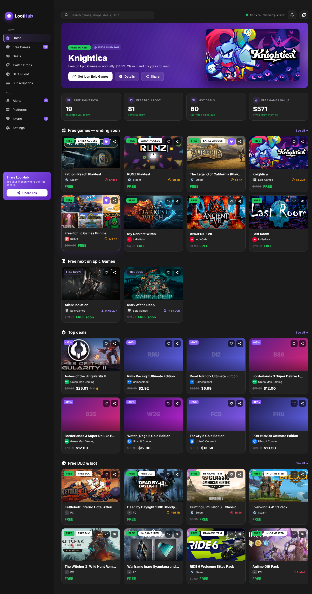
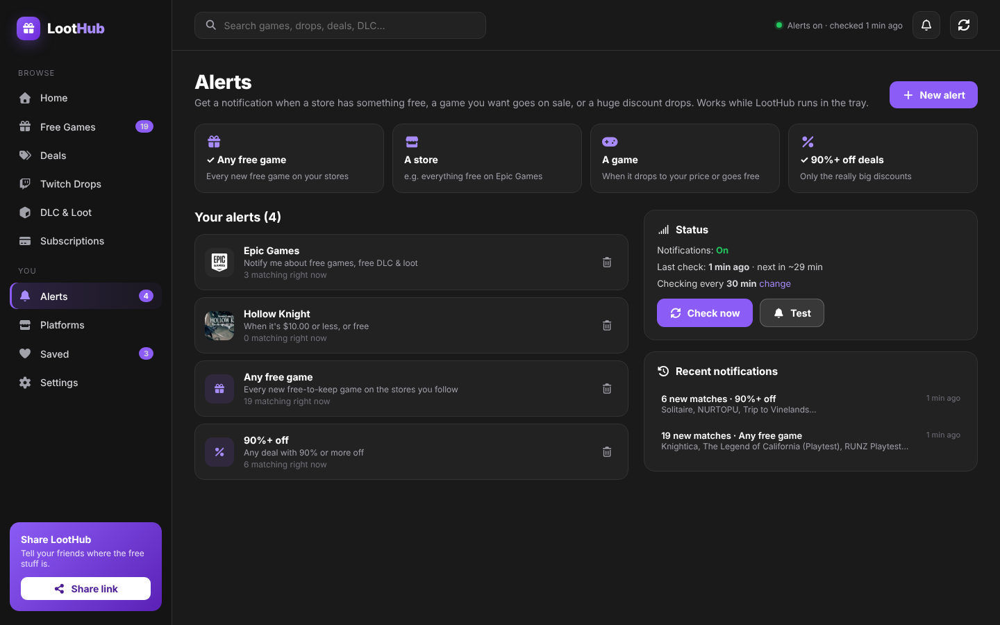

# LootHub

Every free game, deal, DLC, Twitch drop and subscription price across the PC stores — in one app, with alerts.

**PC:** desktop app that sits in the taskbar tray and sends notifications.
**Phone:** the same app as an installable web app (Add to Home screen).

| | |
|---|---|
|  |  |

## Features

- **Free Games** — free-to-keep games, betas and "free next week" on Epic, with countdowns.
- **Deals** — live prices from 15 stores (Steam, Epic, GOG, Ubisoft, Humble, Fanatical, Green Man Gaming, IndieGala, GamersGate, Gamesplanet…), sorting and filters, lowest-price-ever and other stores' prices for each game.
- **DLC & Loot** — free DLC, in-game items, keys and Prime loot.
- **Twitch Drops** — opens Twitch's official Drops page inside the app (sign in once; see campaigns, progress and rewards).
- **Subscriptions** — Discord Nitro, Game Pass, EA Play, Ubisoft+, Humble Choice, Prime, Twitch Turbo…
- **Alerts** — notify me about:
  - a **store** (e.g. everything free on Epic Games, or Steam deals 75%+ off),
  - a **game** (when it hits my price or goes free),
  - **any free game**, or **90%+ off** deals.
- **Open in app** — Steam / Epic links open in the store app when it's installed, otherwise the website.
- **Tray** — closing the window keeps LootHub running in the tray; right-click for Check now, pause notifications, Start with Windows, Quit.
- **Platforms** — follow/hide each of the 20 stores; real store logos.
- Save games, share links, search.

## Run it on your PC

Needs [Node.js](https://nodejs.org) 20+.

```bash
npm install
npm start
```

### Build the installers

```bash
npm run dist:win     # -> dist/LootHub-Setup-1.0.0.exe (installer) + dist/LootHub-Portable-1.0.0.exe (no install)
npx electron-builder --linux   # -> dist/LootHub-1.0.0.AppImage
```

Building the Windows files on Linux needs Wine (64- and 32-bit). On Windows it works out of the box.
The installers aren't code-signed, so Windows SmartScreen shows "Windows protected your PC" the first time —
click **More info → Run anyway**.

Or let GitHub build it: **Actions → Build desktop app → Run workflow**, then download the `LootHub-windows-latest` artifact.

## Phone version

The `app/` folder is a complete web app. Publish it with **GitHub Pages**: in the repo go to *Settings → Pages → Source: GitHub Actions*; the *Publish web app* workflow deploys it on every push to `main`. Open the link on your phone and choose **Add to Home screen**. (On phones, alerts work while the app is open.)

To try it locally: `npm run web` and open http://localhost:5173.

## Where the data comes from

| What | Source |
|---|---|
| Free games & loot | [GamerPower API](https://www.gamerpower.com/api-read) |
| Epic weekly free games (+ next week) | Epic Games Store (desktop app) |
| Deals, price history | [CheapShark API](https://apidocs.cheapshark.com/) — USD prices |
| Subscription prices | Maintained in `app/js/subs.js` (no public API — re-check now and then) |
| Twitch Drops | Twitch's own Drops page (Twitch has no public drops API) |

Store logos: [Simple Icons](https://simpleicons.org) (CC0) and [Font Awesome Free](https://fontawesome.com) (CC BY 4.0); UI icons: Font Awesome. Trademarks belong to their owners; LootHub isn't affiliated with any store. Stores without a public logo use a coloured monogram.

## Project layout

```
app/            the UI (shared by desktop + phone)
  js/app.js       pages, popups, actions
  js/api.js       data feeds
  js/alerts.js    alert rules, checker, notifications
  js/open.js      open-in-app / website, share
  js/platforms.js the 20 stores (logos, colors, app links)
  js/subs.js      subscription prices
electron/       desktop shell: tray, notifications, installed-app check
scripts/        icon generators (npm run icons)
design/         the original design mockup
```
